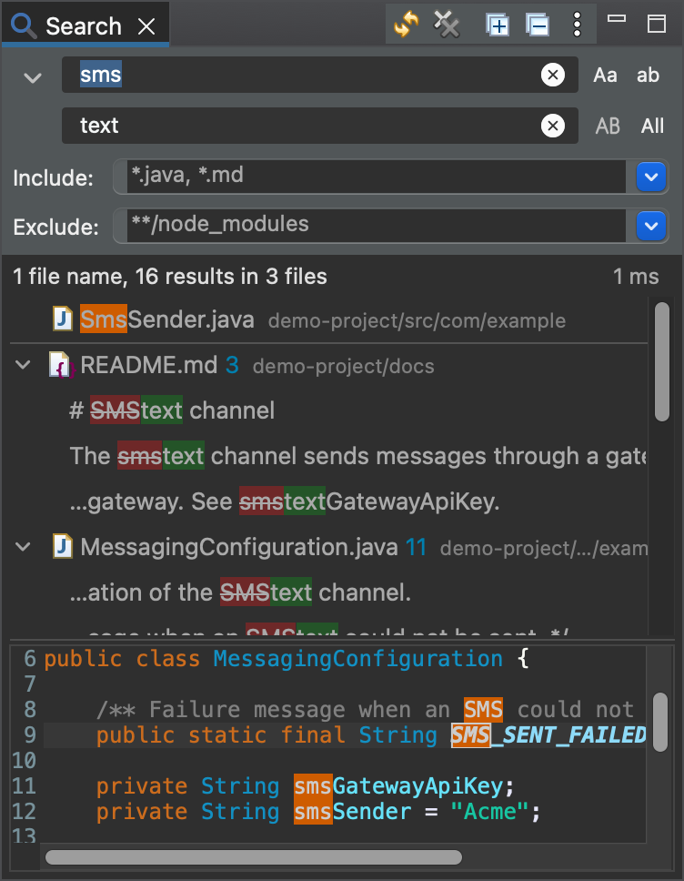

# Eklipse Search

VS Code style search & replace for Eclipse: search as you type across the workspace, results grouped by file, replace
with a live preview. It's a regular view, docked on the right by default.



## Features

- Search as you type, results stream in while the search runs
- Match case, whole word, regular expressions
- *Include* / *Exclude* with VS Code globs
- Files whose name matches come first, camel case included (`ADTE` finds `AbstractDecoratedTextEditor.java`), so `Enter`
  opens a file like *Open Resource*
- Paste a path, a class (`com.acme.Foo#run`) or a stack trace line (`Foo.java:42`) to find the file
- Replace with a preview of every change, preserve case and regex groups (`$1`); everything can be undone
- Preview results in a temporary editor tab or below the results, with syntax colors from JDT and TM4E if installed
- Matches marked in open editors, results updated when files are saved
- Light and dark theme

## Installation

Requires Eclipse 2024-03 or newer on macOS, Windows or Linux (tested on macOS so far).

1. *Help > Install New Software...*, enter `https://eliakocher.github.io/eklipse-search/` in *Work with*.
2. Check *Eklipse Search* and uncheck *Contact all update sites during install to find required software*, otherwise
   Eclipse may also upgrade unrelated plugins.
3. Finish the wizard. When asked, trust the signer *Eklipse Search* with the fingerprint
   `bd16c7887e6a370ece3c202e4a232a6d4ce4a426`, then restart.

To update, repeat these steps. *Help > Check for Updates* contacts all update sites, like leaving the box in step 2
checked.

From the command line, with Eclipse closed (`Eclipse.app/Contents/MacOS/eclipse` on macOS, `eclipsec.exe` on Windows):

```sh
eclipse -nosplash -application org.eclipse.equinox.p2.director \
    -repository https://eliakocher.github.io/eklipse-search/ \
    -installIU com.eklipse.search.feature.feature.group \
    -trustedPGPKeys bd16c7887e6a370ece3c202e4a232a6d4ce4a426 -trustSignedContentOnly
```

## Usage

Open the view with `Ctrl+Alt+Shift+F` (`Cmd+Alt+Shift+F` on macOS) or *Search > Eklipse Search...*; text selected in
the editor prefills the search field. The view's tab is called *Search* and has a blue magnifier. To change the
shortcut, look for *Eklipse Search* in *Preferences > General > Keys*.

| Key | Action |
|---|---|
| `Enter` | open the selected result, `↓` / `↑` pick another |
| `Alt+C` / `Alt+W` / `Alt+R` / `Alt+P` / `Alt+D` | match case / whole word / regex / preserve case / skip derived resources |
| `Alt+↑` / `Alt+↓` | previous searches |
| `Ctrl+Enter` in the replace field | replace all |
| `Delete` | dismiss a result |
| `Ctrl+C` | copy the selected results |

Use `Cmd` instead of `Ctrl` and `⌥` instead of `Alt` on macOS. More options are in the view's ⋮ menu.

*Include* and *Exclude* take comma separated globs, matched case insensitively against workspace paths:

| Glob | Matches |
|---|---|
| `*.java` | Java files in any folder |
| `*.{js,ts}` | `.js` and `.ts` files |
| `src/main/**` | everything below any `src/main` |
| `node_modules` | the folder `node_modules` anywhere, with everything inside |
| `/my-project/docs` | only below `docs` of the project `my-project` |

## Building

Needs Java 21, Maven is downloaded by the wrapper (`mvnw.cmd` on Windows).

```sh
./mvnw verify                                          # plugin, tests and update site
./mvnw verify -Pui-tests                               # plus UI and performance tests
./mvnw verify -Declipse.release=2026-09 -Dbuild.ee=JavaSE-21   # against a newer Eclipse
```

The update site ends up in `com.eklipse.search.site/target/`, as a folder and a zip you can add in *Install New
Software*. Your own build isn't signed, so Eclipse asks whether to trust unsigned content.

## Known limitations

- On Windows and Linux, `Alt+R` / `Alt+W` / `Alt+P` might open Eclipse's menus instead; the buttons always work.
- Results refresh when a file is saved, not while typing in an editor.
- At most 20 000 results, like VS Code.

## License

[MIT](LICENSE)
